  

# Hi, I'm Ahmed Zenaty 👋

Frontend Developer from Gaza, Palestine. I build responsive, bilingual (Arabic/English) web apps with React, Next.js, and TypeScript.

## Tech I work with

  

- **Frontend:** React, Next.js, TypeScript, JavaScript, Tailwind CSS
- **State & data:** React Query, Zustand, REST APIs
- **Backend:** Node.js, Express, PostgreSQL, Prisma, JWT
- **Tools:** Git, GitHub, Vercel, Postman, Jira

## Featured projects

| Project | What it is | Stack | Links |
| --- | --- | --- | --- |
| **PS Scholar** | Scholarship discovery platform for Palestinian students, with Arabic/English (RTL/LTR) support | Next.js, React Query, Tailwind CSS | [Live](https://scholar-ai-neon.vercel.app) · [Code](https://github.com/scholarAI-org/scholarAI-frontend) |
| **GrowFund** | Crowdfunding web app, built as team lead | Next.js, TypeScript | [Live](https://grow-fund-beta.vercel.app) · [Code](https://github.com/ZenatyAh/grow-fund) |
| **Wasla Backend** | REST API for a skill-exchange platform, with JWT refresh-token rotation and Swagger docs | Node.js, Express, PostgreSQL, Prisma | [Code](https://github.com/ZenatyAh/wasla-backend) |

## Experience

- **Full-Stack Developer Trainee**, TAQAT (Jul – Oct 2026)
- **Frontend Developer Intern**, Avatar Information Technology (Apr – Jun 2026)
- **Frontend Developer Trainee & Team Lead**, Gaza Sky Geeks (Aug – Dec 2025)

## Let's connect

- [LinkedIn](https://www.linkedin.com/in/ahmed-zenaty/)
- Email: zenatyah@gmail.com

Open to remote Frontend and Full-Stack roles.
